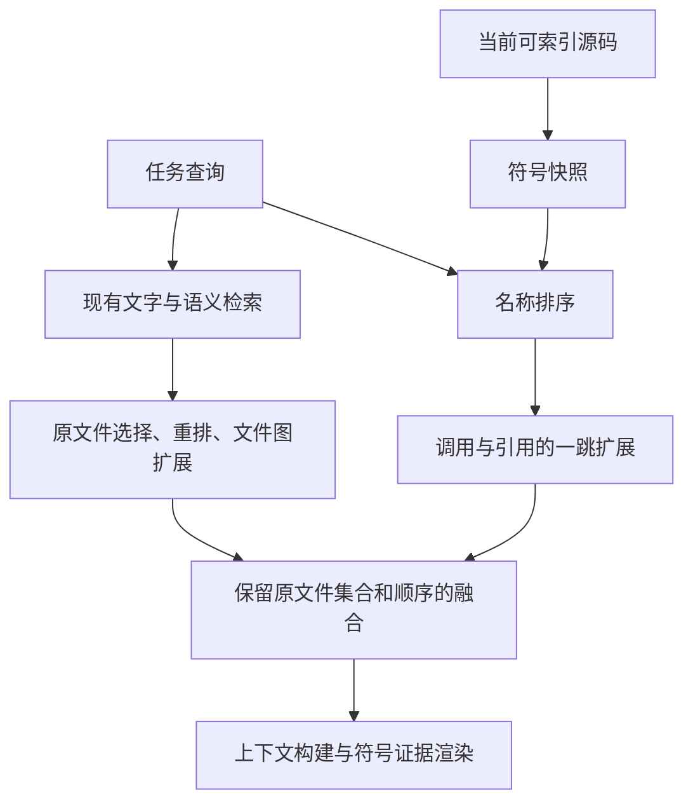

# FE-Agent v1.4.5 实现说明

本轮实现符号感知检索的最小闭环：原文件链路完整执行，符号提供可解释的补充阅读证据，并传递到最终模型上下文。没有修改写权限、影响分析或变更范围解析规则。

## 术语与模块职责

下表先解释本说明中使用的专业词汇；程序标识符沿用仓库名称。

| 英文术语 | 中文解释 | 系统作用与必要性 | 相邻模块关系 |
|---|---|---|---|
| Symbol-aware Retrieval | 符号感知检索，利用函数、类型、组件等实体检索代码 | 将“相关文件”进一步定位到文件中的实体 | 文件检索与符号检索汇合后交给上下文构建 |
| File Retrieval / File-level Recall | 文件检索 / 文件级召回率；后者表示应找到的文件中实际找到的比例 | 保留必要代码、样式、配置、文档等覆盖面，不能要求每个文件都有符号 | 提供本轮融合不可挤出的原始文件集合 |
| Precision | 精确率，即返回结果中真正相关的比例 | 衡量补充证据是否减少无关内容；本轮尚未通过真实任务数据测量提升 | 在保留原文件结果的前提下评估符号排序 |
| Lexical Retrieval | 词法检索，按名称、路径和内容文字搜索 | 保留直接文字匹配能力 | 与语义检索进入混合检索 |
| Semantic Retrieval | 语义检索，把文本转换为向量后比较相似性 | 补充用词不同但意思相关的代码，例如中文需求与英文代码 | 由语义索引返回代码块，再进入混合检索 |
| Hybrid Retrieval | 混合检索，组合文字与语义两路结果 | 避免只依赖一种信号；当前接口和行为保留 | 上接两路搜索，下接文件选择 |
| RRF / Reciprocal Rank Fusion | 倒数排名融合，用各路名次的倒数贡献合成分数 | 避免直接混加量纲不同的搜索分数 | 现有 HybridRetriever 使用；本轮不修改其计算 |
| Rerank | 重排，对已有候选再排序 | 现有可选服务可提高最终文件排序质量 | 仍由原 TaskRetrievalService 调用，符号不挤入其截断过程 |
| Task Context Selection | 任务上下文选择，根据当前代码决定任务阅读哪些文件 | 集中执行检索、依赖扩展和预算控制 | 本轮符号补充的集成入口，下接上下文构建 |
| SymbolIndex | 符号索引，按标识、名称、文件保存代码实体 | 为多种消费者提供共同定义数据 | 上接技术适配器，下接符号排序和引用解析 |
| SymbolGraph | 符号关系图，节点是实体，边是已解析的调用或引用 | 为补充直接相关邻居提供关系证据 | 上接引用解析，下接图扩展 |
| Symbol Candidate | 符号候选，携带名称、位置、分数和来源的记录 | 让命中可解释、可传递、可测试 | 由排序产生，经图扩展进入融合与上下文 |
| Symbol Ranker | 符号排序器，按名称匹配强度排序 | 优先准确标识符，保留同名不同文件的候选 | 读取 SymbolIndex，为图扩展提供种子 |
| Graph Expansion | 图扩展，从种子沿关系边补充邻居 | 发现名称检索未直接命中的调用者、被调用者及引用实体 | 使用 SymbolGraph，输出补充候选 |
| Result Fusion | 结果融合，将符号证据附到文件结果 | 连接符号粒度与文件粒度，同时保护原结果 | 在原文件上下文选择完成后执行 |
| Snapshot | 快照，同一轮读取和解析得到的符号数据集合 | 防止沿用旧代码的符号和关系 | 从当前文件索引构建，供本次符号检索消费 |
| Fail Closed | 保守拒绝解析：证据不足时不猜目标 | 防止未知对象成员产生错误关系边 | 引用解析保留 unsupported 等状态，图构建只接纳 resolved |
| Write Permission | 写入权限，决定允许修改哪些文件的授权规则 | 阅读相关性不能自动变成修改授权 | 仍由既有执行边界与工具权限系统控制 |
| Impact / Change Surface | 影响分析 / 变更范围，分别用于评估影响和约束修改对象 | 属于后续决策领域，本轮没有接入或修改其规则 | 不从符号分数或关系边生成修改目标 |
| Benchmark | 基准评测，用真实任务和标准答案衡量系统效果 | 后续判断检索质量、性能及是否需要更复杂排序 | 本轮仅补诊断字段，没有执行真实外部模型评测 |

## 核实的代码基线

核对日期：2026-10-31，客户端时区 Asia/Shanghai。

远端 `main` 为 [9cd031ee923abd45f2f3f029fccfbdd6025b0b60](https://github.com/coding-man-wang/fe-agent/commit/9cd031ee923abd45f2f3f029fccfbdd6025b0b60)，提交时间 2026-10-31 13:23:02 +08:00。本机 `D:\project\fe-agent` 的已提交版本与远端一致，但有未提交的 4B 实现。本轮在独立副本工作，没有改动 D 盘项目或推送远端。

远端并未完整落地 4B：共享解析器函数仍在类内、定义解析器缺导入且默认导入被旧分支截断、通用引用解析器末尾混入 Vue 代码。交付的前置补丁接纳本机 8 个必要实现文件，并增加局部对象遮蔽命名空间导入的保守处理。

| 模块 | 实际接口与结论 |
|---|---|
| `codebase/hybrid_retrieval.py` | `HybridRetriever.fuse(query, lexical, semantic)`，参数为关键字；返回 `HybridSearchResponse`，按文件汇合两路排名。原样保留。 |
| `codebase/semantic_search.py` | `InMemorySemanticIndex.build(chunks)` 与 `search(query, top_k=5)` 都是异步方法；返回代码块及相似度。原样保留。 |
| `codebase/task_retrieval.py` | `build_query_specs(...)` 产生查询；异步 `retrieve(task, index, ..., semantic_enabled=True)` 完成搜索、文件选择、可选重排与角色分类。原样保留。 |
| `codebase/task_context_selection.py` | 异步 `select(repository_root, repository_revision, task, raw_requirement, requirement_spec)` 先生成当前文件索引、检索结果和文件依赖图，再完成文件扩展。本轮只在末尾增加符号补充。 |
| `code_intelligence/symbol_index.py` | `all_symbols/get_symbol/find_by_name/find_by_file/find_by_file_and_name/find_containing/parent_chain` 可直接复用；不把排序塞进索引。 |
| `code_intelligence/symbol_graph.py` | `outgoing/incoming/all_edges`；前置 4B 增加 `SymbolReferenceGraphBuilder.build(resolutions)`，支持 calls/references，仅接纳已解析关系。保留旧调用图构建器。 |
| `context/model.py`, `builder.py`, `renderer.py` | 文件证据经 `CodeContextItem.symbol_candidates` 转发，非空时渲染 `symbol_evidence`，明确用途为阅读。没有符号证据时保持旧输出格式。 |

4B 支持范围包括命名空间成员调用、类内 this 方法、变量读取、类型引用与 Vue 脚本引用。未知对象方法不依靠全仓同名猜测。远端缺少上一段对话提到的独立 module_export/reference_resolution 测试文件，本轮命令只列真实存在的文件。

## 最小闭环与保留规则



令 `B` 为关闭符号功能时原文件链路最终选中的有序列表，`S` 为本轮符号补充后的列表：

- `B` 是 `S` 的原样前缀；已有文件的原分数、角色、目标匹配字段不变，仅附加符号证据。
- 原 `retrieval_selection` 完全不受符号通道影响；原词法、语义候选生成与重排不变。
- 新文件只使用剩余文件数和字节预算；原结果已占满或超预算时不追加文件，也不删除原文件来腾位置。
- 新文件必须在当前文件索引内、允许索引、实际存在且路径位于仓库内；角色固定为 `reference`，`target_match_type=none`，`policy_score=0`。
- 新文件不伪造原文件检索得分；其排序依据保存在 `symbol_candidates.score`。同文件多个符号去重汇合，不叠加成虚假的文件热度。
- 空符号结果或符号链路失败保留文件结果；错误通过 `symbol_error`，局部解析问题通过 `symbol_issues` 返回。

这里保护的是原链路的输出集合及顺序，不宣称原链路本身达到 100% 召回。原文件图本来就存在文件替换策略，本轮不修改它；符号融合发生在该步骤之后，因此不会额外影响该策略。固定预算下同时保证原文件不丢失与任意新增文件全部进入上下文是不可能的，故满预算时只增强已有文件的实体定位。

## 新增接口与默认行为

```python
snapshot = RepositorySymbolSnapshotBuilder().build(
    file_index=index,
    repository_revision=revision,
)
candidates = SymbolRanker().rank(
    queries=[query.text for query in query_specs],
    symbol_index=snapshot.symbol_index,
    limit=20,
)
candidates = SymbolGraphExpander().expand(
    candidates=candidates,
    symbol_index=snapshot.symbol_index,
    symbol_graph=snapshot.symbol_graph,
    max_neighbors=20,
)
selection = SymbolResultFusion().fuse(
    selection=file_selection,
    index=index,
    candidates=candidates,
    max_files=8,
    max_total_bytes=200_000,
)
```

实际集成通过 `TaskContextSelectionService(..., enable_symbol_retrieval=True)` 启用；构造器默认关闭，保证旧调用兼容。现有命令行的 `_build_context_selection_service` 已开启这项阅读补充，不需要另建搜索或模型客户端。

名称精确匹配得分为 1.0；驼峰、缩写、下划线拆词后得分为 `0.6 × 已匹配名称词数 / 名称总词数`。同一实体被多个查询命中取最高分，避免重复查询堆分。名称匹配不进行中文语义推断，中文意图继续依赖原语义检索。

图扩展只处理已解析的 calls/references，双向一跳，邻居得分为种子的 0.5 倍；循环、重复和悬空端点不会扩大结果。直接候选与邻居分别限额，默认最多 20 + 20 个。路径、行号和实体标识用于稳定排序。

快照每次现读现建，即使调用方版本标记相同也不复用旧符号。只解析允许索引的 `.ts/.tsx/.vue`，单文件读取上限默认 1 MB。其余语言、样式、配置、文档继续由原文件检索覆盖。源码内容不在符号阶段裁剪或替换；上下文构建仍执行原有内容预算。

## 边界与后续工作

本轮没有修改 `agent_core/change_surface`、写入工具、作用域守卫或执行授权规则。符号候选不包含权限字段，图关系不生成修改目标。

符号定位依赖现有解析精度：函数参数遮蔽、动态 this 绑定尚未完整建模；未知对象值来源、类型推断和 Vue 模板引用不在此次最小闭环中。已补局部变量遮蔽的保护，但不能将现有解析器视为完整 TypeScript 编译器。

本轮不增加语义向量或外部模型请求。全量符号扫描与一次线性名称排序适合先验证闭环；大型仓库的耗时、真实召回率和精确率需后续基准评测。符号诊断可用于下一轮选样，不能把通过单元测试等同于检索质量提升已证明。

## 完整测试与交付

交付包中的每份 `.py` 测试都是完整文件，含全部导入、构造辅助函数与断言，没有省略片段。`VALIDATION.md` 记录本次实际命令、通过数量、原始基线对比和未通过项。源码替换文件、前置补丁与 v1.4.5 补丁分别提供，便于对照已有本地 4B 修改。
